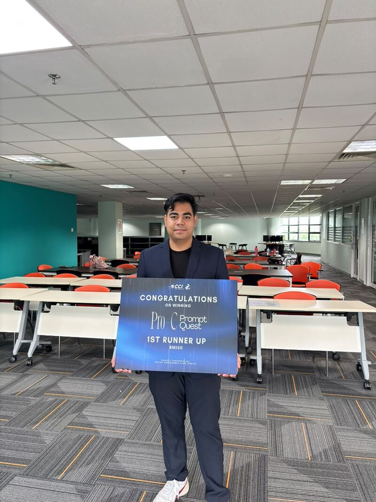

# Hi, I'm Ashraf Syahmie 👋

### Software Engineering Student @ UNITEN

Building useful software through engineering, experimentation, and collaboration.

---

## About Me

I'm a Software Engineering student at Universiti Tenaga Nasional (UNITEN), interested in building practical applications and exploring how technology can solve real-world problems.

I enjoy working across different areas of software development, from designing web and mobile applications to experimenting with AI, Linux, and self-hosted infrastructure.

- 🎓 Pursuing a Bachelor's degree in Software Engineering.
- 👨‍💼 Co-Lead at Google Developer Groups on Campus UNITEN.
- 🥈 2nd Place — PRO-C Prompt Quest AI Mini Hackathon.
- 💻 Building web applications, mobile apps, and developer tools.
- 🐧 Exploring Linux, Docker, cloud technologies, and self-hosting.
- 🌱 Continuously learning through projects and collaboration.

*Learning by building.*

---

## Tech Stack

### Languages & Frameworks

  

### Web & Mobile Development

  

### Tools, Databases & Infrastructure

  

---

## Featured Projects

Projects that reflect my interests in software engineering, practical problem-solving, and experimentation.

### 🌫️ HazeWatch
A haze-monitoring platform designed to make environmental information, air quality observations, and trends easier to understand.

**Focus:** Environmental data · Web development · Data visualization

### 🛡️ Sentinel-U
A campus crisis-management concept exploring emergency coordination, evacuation planning, resource monitoring, and digital-twin technologies.

**Focus:** Crisis management · Software architecture · Digital twin

### 📄 PDFKit
A developer-focused project exploring PDF functionality and document workflows.

**Focus:** Web development · Document processing · Developer tools

[Explore PDFKit →](https://github.com/ashrafsyhmie/pdfkit)

### 🏃 Kinetic
A Flutter-based fitness application exploring mobile application development and activity-related functionality.

**Focus:** Flutter · Mobile development

### 🌱 Thayyib
An AI-assisted halal-compliance concept designed to help manufacturers and SMEs identify potential ingredient and expiry-related issues.

**Focus:** AI integration · Compliance workflows · Problem-solving

[**Explore All My Repositories →**](https://github.com/ashrafsyhmie?tab=repositories)

---

## Achievements & Community

### 🥈 PRO-C Prompt Quest AI Mini Hackathon

**2nd Place**

Recognized for an AI-assisted halal-compliance solution designed for manufacturers and SMEs.

### 🤝 Google Developer Groups on Campus UNITEN

**Co-Lead**

Contributing to developer education, community initiatives, and collaborative learning opportunities.

---

## GitHub Activity

## 🏆 GitHub Achievements

---

## Currently Exploring

- Building reliable and maintainable full-stack applications.
- Integrating AI into practical software products.
- Linux, Docker, and self-hosted infrastructure.
- Software architecture, testing, and deployment workflows.
- Developer tools that improve everyday workflows.

I'm always open to learning from other developers, collaborating on interesting projects, and exploring new ideas.

---

### 🟡 My Contribution Arcade

<picture>
  <source
    media="(prefers-color-scheme: dark)"
    srcset="https://raw.githubusercontent.com/ashrafsyhmie/ashrafsyhmie/pacman-output/pacman-contribution-graph-dark.svg?game=pacman"
  />
  <source
    media="(prefers-color-scheme: light)"
    srcset="https://raw.githubusercontent.com/ashrafsyhmie/ashrafsyhmie/pacman-output/pacman-contribution-graph.svg?game=pacman"
  />
  
</picture>

 

*Thanks for visiting! Keep building, keep learning. 🚀*

